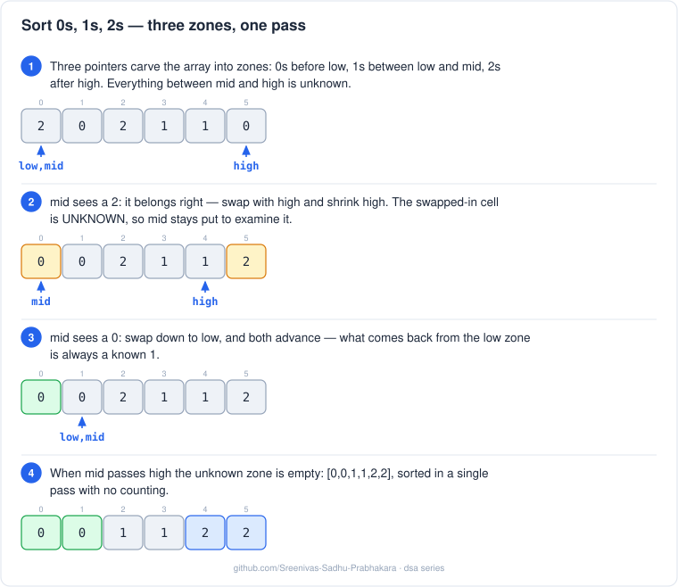

# Sort an Array of 0s, 1s and 2s (Dutch National Flag)

> Striver SDE Sheet 005 · Day 1 Arrays — three-way partition with low/mid/high pointers, one pass, no counting. Go, stdlib only, tested.

## Problem

Sort an array whose elements are only 0, 1 and 2, in place, in a single pass — without counting occurrences first and without a general-purpose sort.

## Approach

Dijkstra's Dutch national flag partition. Maintain three regions via pointers: everything left of `low` is 0, everything between `low` and `mid` is 1, everything right of `high` is 2, and `mid..high` is unexamined. Look at `nums[mid]`: a 0 swaps down to `low` (both advance — what came back is a known 1), a 1 just advances `mid`, a 2 swaps up to `high` (only `high` retreats, because the swapped-in element is unexamined). When `mid` passes `high`, the unknown region is empty and the array is sorted.

**Complexity:** O(n) time, O(1) space, single pass.

## Visual walkthrough

Read the picture top to bottom — each numbered frame is one moment of the algorithm
running on this repo's test example.

## Run

    go test ./...   # verify
    go run .        # demo

---

One of 191 repos solving Striver's SDE Sheet in Go — stdlib only, one problem per repo, every solution tested. Browse the set: [`dsa-*` repos](https://github.com/Sreenivas-Sadhu-Prabhakara?tab=repositories&q=dsa-&type=source).
